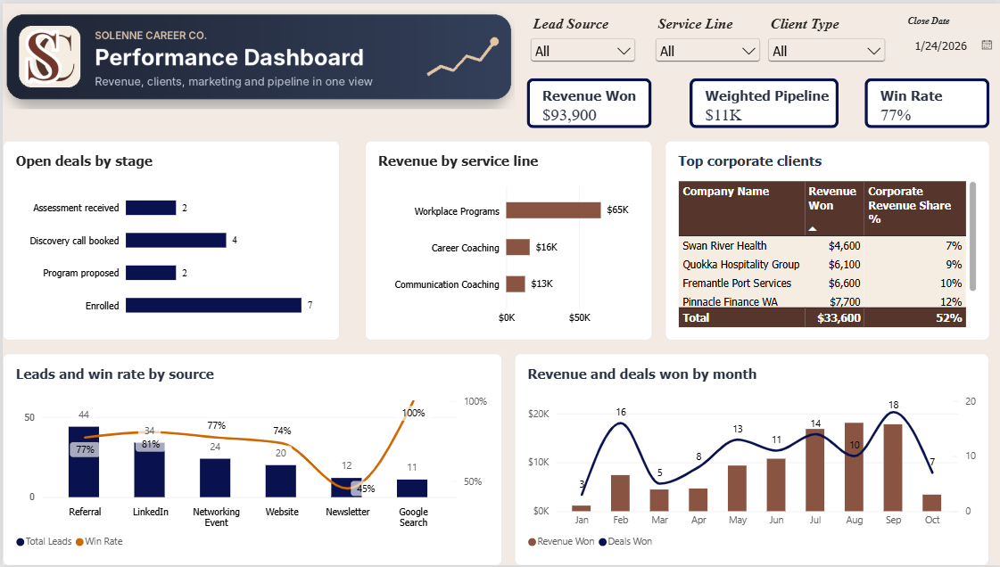

<p align="center"></p>

# HubSpot CRM Implementation and Power BI Analysis
### Solenne Career Co. (a fictional career consultancy)

A hands-on project in which I designed and implemented HubSpot CRM for a small service business, migrated a realistic sample dataset, automated the first client follow-up, and analysed the exported data in Power BI.



> Solenne Career Co. is fictional. All names, emails, phone numbers and figures are sample data created for learning purposes.

---

## Why I built this
A conversation about CRM systems at a Premier Business Network coffee catch-up in Perth reminded me how much I love working with data. With a Master of Business Analytics and a background in HR operations, I turned the weekend into a learning weekend: I taught myself HubSpot from courses and guides, then built a full implementation from scratch, the way a CRM administrator or business systems analyst would.

## The business scenario
| Service line | Clients | Services |
| --- | --- | --- |
| Career Coaching | Individuals | Resume Review, LinkedIn Makeover, Interview Coaching, Career Clarity Program |
| Communication Coaching | Individuals | Public Speaking Coaching, Presentation Skills, Workplace Communication Program |
| Workplace Programs | Companies | Team Communication Workshop, Leadership Coaching Program, Graduate Readiness Program |

Client journey: **free assessment → discovery call → tailored program**.

## What I built
| Area | Delivered |
| --- | --- |
| CRM design | Data model (companies, contacts, deals), 11 custom properties, a 6-stage pipeline with win probabilities |
| Data migration | 20 companies, 193 contacts and 152 deals imported with zero errors and correct associations |
| Daily use | Custom record layouts, list columns, 4 saved views, logged notes, calls and tasks |
| Lead capture | Assessment form with every field connected to a CRM property, consent field and reCAPTCHA |
| Automation | Personalised follow-up email sent automatically on form submission |
| Reporting | HubSpot dashboard plus a one-page Power BI dashboard, with every measure reconciled to HubSpot |

**Tools:** HubSpot CRM (free plan) · Power BI Desktop (Power Query, DAX) · Excel/CSV

## Data model
```
Companies (key: company domain)  1 ──< *  Contacts (key: email)  1 ──< *  Deals (stage, amount, close date)
```
Individual clients are standalone contacts. Only corporate clients link to a company.

**Pipeline – Solenne Client Journey**
| Stage | Probability |
| --- | --- |
| Assessment received | 10% |
| Discovery call booked | 25% |
| Program proposed | 50% |
| Enrolled | 90% |
| Program complete | Won |
| Closed lost | Lost |

## Key insights (sample data)
- **Workplace Programs earn about 69% of revenue** ($64,900 of $93,900) from fewer than a fifth of deals.
- **Referrals and LinkedIn bring 54% of enquiries** and convert at around 77% to 81%.
- **Revenue peaked July to September** (56% of the year's revenue). The October dip reflects programs still in progress.
- **The top five corporate clients generate 52% of corporate revenue.**
- Overall **win rate 77%**, **weighted pipeline $11,178**, **financial year to date $56,150**.

## Challenges and solutions
| Challenge | Solution |
| --- | --- |
| 36 import errors from invalid domains and industry values | Cleaned the source file and created a custom Sector property |
| HubSpot auto-created a company from email domains and linked 125 contacts to it | Deleted it and turned off automatic company association |
| Deals import blocked | Added the required Pipeline column |
| Default reports showed all records in the import month | Kept original dates in custom properties and built trends in Power BI |
| Workshop participants inflated the lead count | Counted only real enquiries (145, not 193) |
| Circular dependency when sorting stages in Power BI | Moved the sort key into Power Query |

## Limitations
- Fictional business and sample data: the insights demonstrate method, not real market findings.
- HubSpot's free plan does not include custom reports, conditional form logic or multi-step workflows.
- The migrated data held only each deal's final stage, so it cannot show where lost deals dropped out.

## Next steps
- Multi-step follow-up workflows and a self-booking meetings link
- HubSpot certification and integrations with tools like Xero

## How to explore it
1. Import the three CSV files into a free HubSpot account: companies, then contacts, then deals.
2. In Power BI, load the CSV files, apply `Solenne_Coffee_theme.json`, and recreate the measures from `measures.dax`.

---
**Aniqa Tabassum** · Master of Business Analytics, University of Western Australia · Perth, Australia
